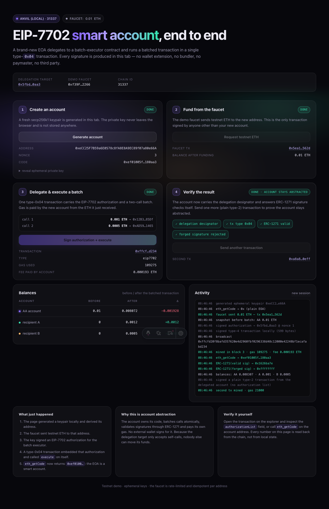

# EIP-7702 smart account demo

An end-to-end, working demo of [EIP-7702](https://eips.ethereum.org/EIPS/eip-7702) account abstraction in TypeScript:

1. **Create** a brand-new account (keypair generated in the browser).
2. **Fund** it with testnet ETH from a demo faucet.
3. **Delegate + execute**: one type-`0x04` transaction carries an EIP-7702 authorization and a two-call batch, paid for by the account itself.
4. **Verify** the result with before/after balances read back from the chain, the `0xef0100…` delegation designator and ERC-1271 signature checks.

No wallet extension, no bundler, no paymaster, no third-party SDK. The page signs everything locally; the server only relays bytes and runs the faucet.

- **Live demo:** _added after deployment_
- **Sepolia proof:** [`docs/PROOF.md`](docs/PROOF.md)
- **Delegation target:** printed by `bun run deploy:impl`



---

## How it works

```
browser                                              chain
─────────────────────────────────────────────────────────────────────────────
1. generatePrivateKey() ──────────► new EOA
2. POST /api/fund ────────────────► faucet key sends 0.01 ETH ───────────────►
3. signAuthorization(impl, nonce+1)
   signTransaction({ to: self,
     data: execute([call1, call2]),
     authorizationList: [auth] })  ──► POST /api/broadcast ──► type-0x04 tx ─►
4. eth_getCode → 0xef0100‖impl
   ERC-1271 isValidSignature → 0x1626ba7e
   balances before/after ◄────────── /api/state, /api/rpc ◄────────────────────
```

### The three details that usually break this

1. **Authorization nonce = transaction nonce + 1.** The authorization list is processed *after* the sender's nonce is incremented, so a self-executing type-4 transaction must sign the authorization over `nonce + 1`. See `authorizationNonce()` in `src/lib/eip7702.ts`.
2. **The delegation target must only accept self-calls.** When code is delegated, `address(this)` is the EOA. `BatchExecutor.execute` requires `msg.sender == address(this)`, so a third party can never call it on your account.
3. **An empty `authorization_list` is invalid.** EIP-7702 states the transaction is invalid if the list is empty, so the "second transaction" demo uses a plain type-2 transaction from the now-delegated account.

### Why this is account abstraction

- The account **owns code** (`0xef0100 ‖ implementation`) and can **batch** calls atomically.
- It **pays its own gas** from the ETH it received — no relayer or paymaster required.
- It **validates signatures** through ERC-1271 (`isValidSignature`) instead of only ECDSA-from-EOA.
- The delegation can be swapped or cleared later by signing a new authorization (chain id 0 = valid on all chains).

## Stack

| Layer | Choice |
| --- | --- |
| App | [Astro 7](https://astro.build) (`output: 'server'`) + vanilla TypeScript island |
| Chain access | [viem](https://viem.sh) 2.x (`signAuthorization`, `authorizationList`, type-4 serialization) |
| Contract | `BatchExecutor.sol`, compiled with `solc-js` (`bun run compile`) |
| Hosting | Vercel (`@astrojs/vercel`) |
| Tests | `bun test` (unit + anvil integration), Playwright (E2E) |

## Run locally

Requires [Bun](https://bun.sh), [Foundry](https://getfoundry.sh) (`anvil`), and Node ≥ 22.23.4.

```bash
bun install
bun run compile          # compiles BatchExecutor.sol -> src/lib/generated/batchExecutor.ts
bun run demo:local       # starts anvil (prague), deploys the target, runs astro dev
# open http://localhost:4321
```

`bun run demo:local` uses anvil's default accounts, so no testnet ETH is needed.

## Run on Sepolia

```bash
cp .env.example .env
# set FUNDER_PRIVATE_KEY to a key you fund from any Sepolia faucet (0.05 ETH is plenty)

bun run deploy:impl      # deploys BatchExecutor, writes IMPLEMENTATION_ADDRESS to .env
bun run dev              # http://localhost:4321 against Sepolia
bun run proof:sepolia    # full flow + assertions -> docs/PROOF.md
```

Environment variables:

| Variable | Purpose |
| --- | --- |
| `CHAIN_ID` | `11155111` (Sepolia) or `31337` (anvil) |
| `SEPOLIA_RPC_URL` | JSON-RPC endpoint |
| `FUNDER_PRIVATE_KEY` | demo faucet key (server-side only) |
| `IMPLEMENTATION_ADDRESS` | deployed `BatchExecutor` |
| `RECIPIENT_ADDRESS`, `RECIPIENT2_ADDRESS` | demo recipients |
| `MAX_FUND_ETH`, `FAUCET_FLOOR_ETH`, `MIN_FUNDED_BALANCE_ETH` | faucet policy |

## Tests

```bash
bun test          # unit + integration (spawns anvil --hardfork prague)
bun run test:e2e  # Playwright: real browser, real chain, asserts on-page balances
```

What is actually proven:

**Integration (`tests/integration/7702.anvil.test.ts`)**
- one type-0x04 transaction delegates the EOA **and** executes a 2-call batch
- `eth_getCode` becomes `0xef0100 ‖ implementation`
- the account pays `value + gasUsed × effectiveGasPrice` itself
- nonce advances by 2 (tx + applied authorization)
- ERC-1271 returns the magic value for the account's signature
- an authorization with a stale nonce is skipped (no delegation)
- a third party calling `execute` reverts with `NotSelf`
- a delegated account can still receive ETH
- a second transaction runs without re-delegating

**E2E (`tests/e2e/demo.spec.ts`)**
- clicks through create → fund → execute → verify in Chromium
- asserts the before/after/delta numbers rendered on the page (`0.01 → 0.0083…`, `+0.001`, `+0.0005`)
- asserts `data-ok` verification badges (designator, tx type, ERC-1271 valid + forged rejected)
- asserts the second transaction updates the balance table
- asserts the relay rejects unsupported tx types and type-2 txs from non-delegated senders
- fails on any browser console error

**Sepolia (`bun run proof:sepolia`)**
- runs the same flow on the live testnet and writes [`docs/PROOF.md`](docs/PROOF.md) with tx hashes, balances and check results

## Security model

- The private key is generated in the browser and **never** sent to the server; it lives in memory only (a reload creates a new account).
- The server signs exactly one kind of transaction: the fixed faucet amount to a caller-supplied address.
- Faucet guards: idempotent per address, fixed amount, faucet balance floor, per-IP rate limit.
- `/api/broadcast` only accepts type-0x04 transactions and type-0x02 transactions **from accounts that already carry a delegation designator**, so it cannot be used as a generic relay.
- `/api/rpc` is a read-only JSON-RPC allow-list (no `eth_sendRawTransaction`).
- `BatchExecutor` is stateless, has no owner, and only executes calls when invoked by the delegated account itself.

## Project layout

```
contracts/BatchExecutor.sol     delegation target: execute(Call[]), ERC-1271, receive
scripts/compile.ts              solc-js -> typed ABI + bytecode
scripts/deploy-impl.ts          deploy the target, write IMPLEMENTATION_ADDRESS
scripts/local.ts                anvil + deploy + astro dev (bun run demo:local)
scripts/proof-sepolia.ts        live testnet proof -> docs/PROOF.md
src/lib/eip7702.ts              designator decoding, calldata, auth nonce rule
src/lib/tx.ts                   build/sign type-4 batch + plain txs
src/lib/server/                 env, RPC clients, faucet, rate limiting
src/pages/api/                  config, state, fund, broadcast, rpc
src/pages/index.astro           demo UI
src/scripts/demo.ts             browser flow (viem, no framework)
tests/                          unit, integration (anvil), e2e (Playwright)
```

## Limitations

- Testnet only: the faucet is funded with Sepolia ETH and the demo is rate-limited.
- Reloading the page loses the ephemeral key (by design).
- Public RPCs can be flaky; set `SEPOLIA_RPC_URL` to a dedicated endpoint for reliability.
